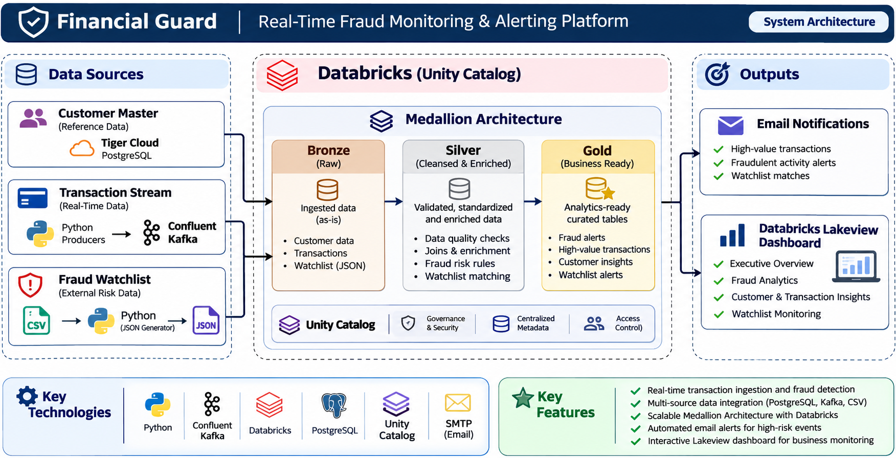

# Financial Guard
### Real-Time Credit Card Transaction Monitoring & Fraud Detection

Financial Guard is an end-to-end data engineering project demonstrating real-time credit card transaction monitoring, rule-based fraud detection, automated email alerts, and interactive analytics using Apache Kafka, Confluent Cloud, and Azure Databricks.

The solution integrates customer master data, streaming transaction events, and fraud watchlist records into a unified data processing architecture using the **Medallion Architecture (Bronze, Silver, and Gold)**.

---

## Table of Contents

- [Project Overview](#project-overview)
- [Architecture](#architecture)
- [Technology Stack](#technology-stack)
- [Key Features](#key-features)
- [Data Ingestion](#data-ingestion)
- [Medallion Architecture](#medallion-architecture)
- [Fraud Monitoring and Alerting](#fraud-monitoring-and-alerting)
- [Dashboard](#dashboard)
- [Project Evidence](#project-evidence)
- [Repository Structure](#repository-structure)
- [Setup and Configuration](#setup-and-configuration)
- [Important Project Notes](#important-project-notes)
- [Limitations and Future Improvements](#limitations-and-future-improvements)
- [License](#license)

---

## Project Overview

Financial Guard monitors incoming credit card transactions and identifies potentially suspicious activity through configurable business rules and fraud watchlist matching.

The project implements three independent data ingestion pipelines:

1. **Customer Master Data:** Customer records are ingested from Tiger Cloud PostgreSQL into Databricks through a configured ingestion pipeline.
2. **Transaction Streaming:** Python-based producers generate synthetic transaction events and publish them to Confluent Cloud Kafka.
3. **Fraud Watchlist:** Watchlist CSV records are converted into individual JSON files and ingested into Databricks using Auto Loader.

The ingested data is processed through Bronze, Silver, and Gold layers. Gold outputs support automated email notifications and an interactive Databricks Lakeview dashboard.

### Business Use Cases

- Identify transactions exceeding customer-specific transaction limits.
- Detect transactions involving cards present in a fraud watchlist.
- Monitor transaction activity through tumbling and sliding-window aggregations.
- Generate email notifications for high-value transactions and watchlist matches.
- Analyse transaction trends and fraud-related activity through a dashboard.

---

## Architecture



### High-Level Data Flow

```text
                    CUSTOMER DATA
                          |
                          v
               Tiger Cloud PostgreSQL
                          |
                          v
                Databricks Ingestion
                          |
                          v
                 Bronze / Silver
                    Customers
                          |
                          |
                          v
TRANSACTION DATA                 FRAUD WATCHLIST
      |                                |
      v                                v
Python Producers                  Watchlist CSV
      |                                |
      v                                v
Confluent Cloud Kafka          Python JSON Generator
      |                                |
      v                                v
Bronze Transactions          Unity Catalog Volume
      |                                |
      v                                v
Silver Transactions              Auto Loader
      |                                |
      |                                v
      |                         Bronze / Silver
      |                            Watchlist
      |                                |
      +---------------+----------------+
                      |
                      v
                  GOLD LAYER
                      |
          +-----------+-----------+
          |           |           |
          v           v           v
      High-Value   Fraud Card  Transaction
       Alerts       Alerts    Aggregations
          |           |
          v           v
       Email        Email
       Sink         Sink
          |
          v
       Email Notifications

             GOLD AGGREGATIONS
                    |
                    v
        Databricks Lakeview Dashboard
```

### Processing Flow

| Stage | Description |
|---|---|
| Source | PostgreSQL, Kafka events, and fraud watchlist CSV |
| Ingestion | Databricks ingestion pipeline, Kafka streaming, and Auto Loader |
| Bronze | Raw source data and ingestion metadata |
| Silver | Structured, standardised, and quality-checked records |
| Gold | Business-oriented alert tables and transaction aggregations |
| Notifications | Email alerts for high-value transactions and watchlist matches |
| Visualization | Databricks Lakeview fraud monitoring dashboard |

---

## Technology Stack

| Category | Technologies |
|---|---|
| Programming | Python, SQL, PySpark |
| Streaming | Apache Kafka, Confluent Cloud |
| Data Engineering | Azure Databricks, Lakeflow Spark Declarative Pipelines |
| Database | Tiger Cloud PostgreSQL |
| Storage | Unity Catalog Volumes |
| Ingestion | Databricks Auto Loader |
| Architecture | Medallion Architecture |
| Processing | Structured Streaming |
| Visualization | Databricks Lakeview Dashboard |
| Notifications | Gmail SMTP with STARTTLS |

---

## Key Features

- Real-time transaction event ingestion using Apache Kafka.
- Synthetic normal and fraud-scenario transaction generation.
- Customer master data ingestion from PostgreSQL.
- File-based fraud watchlist ingestion using Databricks Auto Loader.
- Bronze, Silver, and Gold data processing layers.
- Data quality expectations in Silver transaction processing.
- Customer-specific high-value transaction detection.
- Fraud watchlist matching against transaction card numbers.
- One-minute tumbling-window transaction aggregations.
- Five-minute sliding-window aggregations with one-minute slides.
- Automated email notifications using Gmail SMTP.
- Interactive fraud monitoring and analytics dashboard.

---

## Data Ingestion

### 1. Customer Master Data

Customer master records are maintained in Tiger Cloud PostgreSQL and ingested into Databricks through a configured ingestion pipeline.

The ingested records are processed into the Silver layer and used to enrich transaction and fraud alert datasets.

### 2. Transaction Streaming

Python producers generate synthetic credit card transaction events and publish them to Confluent Cloud Kafka.

The transaction producers support normal transactions and different fraud scenarios.

The Databricks streaming pipeline:

1. Consumes Kafka messages.
2. Preserves the original event payload and Kafka metadata in Bronze.
3. Parses the JSON transaction payload in Silver.
4. Applies data quality expectations and standardisation.
5. Makes structured transaction data available for Gold processing.

### 3. Fraud Watchlist Ingestion

Fraud watchlist records are maintained in CSV format.

A Python utility converts individual CSV records into JSON files and places them in a Unity Catalog Volume.

Databricks Auto Loader detects and ingests the JSON files into the Bronze watchlist table.

The Silver layer performs standardisation and data type conversion before the records are used in fraud matching.

---

## Medallion Architecture

Financial Guard follows the Medallion Architecture to separate raw ingestion, data refinement, and business-level processing.

### Bronze Layer

The Bronze layer stores incoming source data with minimal transformation.

**Main datasets:**

- `financial_guard.bronze.transactions`
- `financial_guard.bronze.fraud_watchlist`

The transaction Bronze table preserves Kafka metadata, including:

- Message key
- Payload
- Topic
- Partition
- Offset
- Event timestamp
- Ingestion timestamp

### Silver Layer

The Silver layer transforms raw records into structured datasets.

**Main datasets:**

- `financial_guard.silver.transactions`
- `financial_guard.silver.fraud_watchlist`
- `financial_guard.silver.customers`

**Processing includes:**

- JSON parsing and schema application.
- Data type conversion.
- Column standardisation.
- Data quality expectations.
- Ingestion metadata.

### Gold Layer

The Gold layer contains business-oriented datasets used for fraud monitoring, notifications, and analytics.

| Dataset | Purpose |
|---|---|
| `financial_guard.gold.high_value_transaction_alert` | Identifies transactions exceeding configured customer transaction limits |
| `financial_guard.gold.fraud_card_alert` | Identifies transactions matching fraud watchlist card entries |
| `financial_guard.gold.transactions_count_by_minute` | Calculates transaction counts using one-minute tumbling windows |
| `financial_guard.gold.transactions_count_by_minute_sliding_window` | Calculates transaction counts using five-minute windows sliding every minute |

---

## Fraud Monitoring and Alerting

### 1. High-Value Transaction Detection

Financial Guard compares incoming transaction amounts against the configured transaction limit associated with the customer.

**Business rule:**

```python
transaction_amount > customer_transaction_limit
```

When a transaction exceeds the configured limit, the Gold processing logic generates a high-value transaction alert.

The generated alert is passed to the high-value email notification sink.

### 2. Fraud Watchlist Matching

Transaction card numbers are matched against card entries in the Silver fraud watchlist.

**Matching condition:**

```sql
transactions.card_number = fraud_watchlist.entity_id
```

When a match is identified, the Gold processing logic generates an enriched fraud alert containing transaction and watchlist information.

The alert includes details such as:

- Risk level
- Watchlist information
- Transaction details
- Location comparison

### 3. Transaction Window Aggregations

Financial Guard implements two types of transaction aggregations:

| Aggregation | Configuration |
|---|---|
| Tumbling Window | One-minute window |
| Sliding Window | Five-minute window, sliding every one minute |

These aggregations support transaction activity monitoring through the Gold layer.

### 4. Automated Email Notifications

Two notification workflows are implemented:

| Notification Sink | Trigger |
|---|---|
| `email_alert_sink` | High-value transaction alerts |
| `fraud_email_alert_sink` | Fraud watchlist matches |

The notification sinks use Gmail SMTP with STARTTLS.

Credentials are retrieved through Databricks secrets rather than being embedded directly in the notification logic.

Card numbers in fraud notification emails are masked.

---

## Dashboard

Financial Guard includes an interactive Databricks Lakeview dashboard with four analytical pages and 26 widgets.

### 1. Executive Overview

Provides an overview of:

- Total transaction activity.
- Transaction volume.
- Fraud alerts.
- High-value alerts.
- Merchant categories.
- Payment channels.
- Transaction trends.

### 2. Fraud Analytics

Provides insights into:

- Risk-level distribution.
- Location mismatch analysis.
- Merchant-category insights.
- Watchlist reasons.
- Recent fraud alerts.

### 3. Customer & Transaction Insights

Provides:

- Customer transaction analysis.
- Top transaction cities.
- Top customers by transaction volume.
- High-value alert details.

### 4. Watchlist Monitoring

Provides:

- Active watchlist records.
- Risk distribution.
- Reporting sources.
- Reason codes.
- Reporting teams.
- Recent watchlist activity.

---

## Project Evidence

The following resources provide visual evidence of the implementation and historical execution.

### Architecture

[View System Architecture Diagram](docs/architecture/Financial Guard System Architecture.png)

### Pipeline Demonstration

[View Pipeline Demo Video](docs/videos/)

### Screenshots

| Component | Evidence |
|---|---|
| Kafka Streaming | [Kafka Topics and Messages](docs/screenshots/kafka/) |
| Fraud Watchlist | [Watchlist JSON Records](docs/screenshots/watchlist/) |
| Databricks Pipeline | [Pipeline Execution Evidence](docs/screenshots/databricks-pipeline/) |
| Databricks Tables | [Transaction and Alert Tables](docs/screenshots/databricks-tables/) |
| Dashboard | [Four Dashboard Pages](docs/screenshots/dashboard/) |
| Email Notifications | [Sample Email Alerts](docs/screenshots/email-alerts/) |

**Evidence note:** Screenshots, email examples, and dashboard metrics are historical demonstrations using synthetic data. They do not represent live production monitoring.

---

## Repository Structure

```text
financial-guard/
│
├── README.md
├── LICENSE
├── .gitignore
│
├── kafka-producer/
│   ├── producer_normal.py
│   ├── producer_fraud_transaction.py
│   ├── producer_fraud_card.py
│   ├── config.py
│   ├── customer_generator.py
│   ├── merchant_generator.py
│   ├── transaction_generator.py
│   ├── fraud_engine.py
│   ├── models.py
│   ├── utils.py
│   ├── consumer.py
│   ├── requirements.txt
│   └── README.md
│
├── databricks/
│   ├── bronze/
│   ├── silver/
│   ├── gold/
│   ├── alerts/
│   ├── customer-ingestion/
│   ├── dashboard/
│   └── fraud-watchlist/
│
└── docs/
    ├── architecture/
    │   ├── README.md
    │   └── financial-guard-architecture.png
    │
    ├── screenshots/
    │   ├── README.md
    │   ├── kafka/
    │   ├── watchlist/
    │   ├── databricks-pipeline/
    │   ├── databricks-tables/
    │   ├── dashboard/
    │   └── email-alerts/
    │
    └── videos/
        ├── README.md
        └── Recording 2026-11-01 152341.mp4
```

---

## Setup and Configuration

### Prerequisites

- Python 3.x
- Confluent Cloud Kafka account or compatible Kafka cluster
- Azure Databricks workspace
- Unity Catalog enabled
- PostgreSQL source database
- Gmail account configured for SMTP notifications

### 1. Clone the Repository

```bash
git clone https://github.com/Trevor04sys/financial-guard.git

cd financial-guard
```

### 2. Set Up the Python Environment

Navigate to the Kafka producer directory:

```bash
cd kafka-producer
```

Create a virtual environment:

```bash
python -m venv venv
```

Activate it on Windows PowerShell:

```powershell
.\venv\Scripts\Activate.ps1
```

Install dependencies:

```bash
pip install -r requirements.txt
```

### 3. Configure Kafka Credentials

Create a local `.env` file using `.env.example` as a template.

Configure the required Kafka connection settings.

Do not commit `.env` or any credentials to GitHub.

### 4. Configure Databricks

1. Configure the required source connections.
2. Create the required Unity Catalog catalog, schemas, and volume.
3. Configure the customer ingestion pipeline.
4. Import the Databricks notebooks or pipeline source files.
5. Configure Kafka connection details using Databricks secrets.
6. Configure email credentials securely.
7. Update source paths and table references for your workspace.
8. Configure and run the Lakeflow pipeline.
9. Import the Lakeview dashboard.

**Reproduction note:** The original Databricks workspace configuration, connections, secrets, and deployed pipeline settings may need to be recreated manually.

---

## Important Project Notes

- This is an educational and portfolio data engineering project using synthetic data.
- Fraud identification is based on rule-based watchlist matching and configured business conditions, not a trained machine learning model.
- The Confluent Cloud environment used during development was a free trial. Historical screenshots and recordings demonstrate earlier successful streaming activity. A new Kafka cluster and credentials may be required to reproduce the pipeline.
- Dashboard metrics are historical example results and are not live production metrics.
- Email delivery depends on valid SMTP credentials and configuration.
- This project is not a production banking or payment security system.

---

## Limitations and Future Improvements

Potential areas for further development:

- Implement alert deduplication and idempotent notification handling.
- Improve watchlist record deduplication and update handling.
- Add retry and failure recovery mechanisms for email notifications.
- Improve schema evolution and error handling.
- Add automated deployment and testing.
- Integrate additional fraud detection rules and model-based scoring.

---

## License

This project is licensed under the MIT License. See the [LICENSE](LICENSE) file for details.

---

## Author

**Raj Pramalick**

Data Engineering | Azure Databricks | Apache Kafka | PySpark | Python

[GitHub Repository](https://github.com/Trevor04sys/financial-guard)
